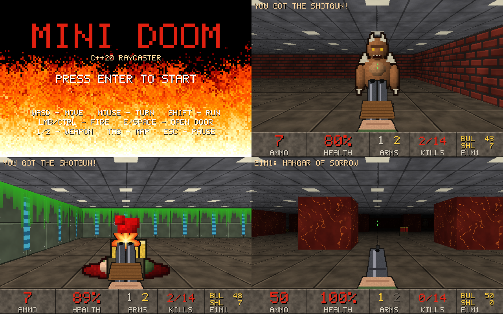

# MINI DOOM на C++20

Исходники к книге о том, как с нуля написать игру в духе Doom на современном C++:
от «Hello, World» в консоли до псевдо-3D с текстурами, монстрами, оружием,
звуком, уровнями в файлах, тестами и CMake. Ни одной чужой картинки и звука —
всё рисуется и синтезируется кодом.



## Что здесь лежит

```
MiniDoom/
├── CMakeLists.txt          все примеры и игра одной сборкой
├── CMakePresets.json       debug (санитайзеры), release, vs-debug
├── examples/
│   ├── CMakeLists.txt      цели для каждого примера каждой главы
│   ├── ch01 … ch29         примеры по главам книги
│   ├── ch29/doom           ★ итоговая игра (своя сборка и тесты)
│   └── app                 примеры из приложений
├── docs/                   картинки для README
└── .github/workflows/      автосборка и тесты на Linux и Windows
```

Каждая глава — папка `examples/chNN`. Одиночный `.cpp` — отдельная программа
из листинга. Подпапка — проект из нескольких файлов: `main_win32.cpp` — окно
Windows, `test.cpp` — автотест без окна, остальное — ядро игры.

| Папка | Глава | Что внутри |
|---|---|---|
| | **Часть I. Учимся держать оружие — основы C++ в консоли** | |
| [`ch01`](examples/ch01) | Глава 1. Hello, Doom | 9 программ |
| [`ch02`](examples/ch02) | Глава 2. Переменные и типы | 17 программ |
| [`ch03`](examples/ch03) | Глава 3. Ветвления и циклы | 16 программ |
| [`ch04`](examples/ch04) | Глава 4. Функции и файлы | 11 программ; `duel/` — дуэль в трёх файлах, `link_missing/` — ошибка компоновки (намеренно), `odr/` — двойное определение (намеренно) |
| [`ch05`](examples/ch05) | Глава 5. Контейнеры и строки | 10 программ |
| [`ch06`](examples/ch06) | Глава 6. Свои типы | 11 программ; `rogue/` — рогалик со структурами |
| [`ch07`](examples/ch07) | Глава 7. Классы | 8 программ; `rogue/` — рогалик на классах |
| [`ch08`](examples/ch08) | Глава 8. Память без страха | 10 программ; `hunt/` — охота на три бага |
| | **Часть II. Окно в ад — пиксели и Windows** | |
| [`ch09`](examples/ch09) | Глава 9. Своё окно | 2 программы; `esc/` — закрытие по Esc (ответ), `noquit/` — окно, которое не закрывается (упражнение), `window/` — первое окно |
| [`ch10`](examples/ch10) | Глава 10. Пиксели | 3 программы; `flipped/` — картинка вверх ногами (баг), `noredraw/` — окно без перерисовки (баг), `pixels/` — кадровый буфер |
| [`ch11`](examples/ch11) | Глава 11. Игровой цикл | 2 программы; `loop/` — игровой цикл |
| [`ch12`](examples/ch12) | Глава 12. Управление | `input/` — клавиатура и мышь |
| [`ch13`](examples/ch13) | Глава 13. Текст на экране | 2 программы; `text/` — шрифт 5×7 |
| | **Часть III. Третье измерение — рейкастинг** | |
| [`ch14`](examples/ch14) | Глава 14. Вид сверху | 4 программы; `top/` — карта сверху |
| [`ch15`](examples/ch15) | Глава 15. Бросаем лучи | 3 программы; `rays/` — лучи DDA |
| [`ch16`](examples/ch16) | Глава 16. Стены встают | 2 программы; `fisheye/` — рыбий глаз (баг), `walls/` — первое 3D |
| [`ch17`](examples/ch17) | Глава 17. Текстуры | 2 программы; `ascii/` — текстура в консоли, `tex/` — текстуры |
| [`ch18`](examples/ch18) | Глава 18. Пол, потолок и тьма | 2 программы; `floor/` — пол, потолок, свет |
| [`ch19`](examples/ch19) | Глава 19. Двери | `doors/` — двери |
| | **Часть IV. Здесь кто-то есть — спрайты, оружие, монстры** | |
| [`ch20`](examples/ch20) | Глава 20. Спрайты | 2 программы; `nozbuf/` — спрайты без Z-буфера (баг), `sprites/` — спрайты и предметы |
| [`ch21`](examples/ch21) | Глава 21. Рисуем монстров кодом | 3 программы; `monsters/` — монстры кодом |
| [`ch22`](examples/ch22) | Глава 22. Оружие | 3 программы; `guns/` — оружие |
| [`ch23`](examples/ch23) | Глава 23. Мозги монстров | 2 программы; `ai/` — мозги монстров |
| [`ch24`](examples/ch24) | Глава 24. Поиск пути | 3 программы; `path/` — поиск пути |
| [`ch25`](examples/ch25) | Глава 25. Огонь и смерть | 3 программы; `fire/` — огонь и смерть |
| | **Часть V. Шум, свет и финальные титры** | |
| [`ch26`](examples/ch26) | Глава 26. Звук из ничего | 5 программ; `sound/` — звук, `wav/` — все звуки игры в WAV |
| [`ch27`](examples/ch27) | Глава 27. HUD и экраны | 2 программы; `screens/` — экраны и статус-бар |
| [`ch28`](examples/ch28) | Глава 28. Уровни | 2 программы; `levels/` — уровни в файлах |
| [`ch29`](examples/ch29) | Глава 29. Как у взрослых | 2 программы; `chaos_bug/` — игра с подложенным багом, `doom/` — **итоговая игра**, `tidy_before/` — код до clang-tidy |

Всего: 133 консольных программ, 26 программ для Windows,
20 автотестов глав и итоговая игра с тремя тестами.

## Как собрать

### Visual Studio 2026

1. Установи нагрузку «Разработка классических приложений на C++» (в неё входят CMake и Ninja).
2. **Файл → Открыть → Папка…** и выбери папку `MiniDoom`.
3. В списке конфигураций вверху выбери `vs-debug`, в списке целей — `minidoom.exe`, и жми F5.

Каждый пример главы — своя цель: `ch16_walls`, `ch22_guns`, `ch02_damage`…

### Командная строка (Windows, Linux, macOS)

Нужны CMake 3.25+, Ninja и компилятор с C++20 (MSVC 2022+, GCC 13+, Clang 17+).

```sh
cmake --preset release
cmake --build --preset release
ctest --preset release
```

Пресет `debug` (не Windows) собирает с AddressSanitizer и UBSan и превращает
предупреждения в ошибки — так собиралось всё в книге.

Под Linux и macOS собираются консольные примеры, автотесты и ядро игры;
окна и звук — только Windows (`main_win32.cpp`, `audio_win32.cpp`).

### Запуск игры

`minidoom.exe` ищет уровни `*.lvl` рядом с собой — сборка кладёт их туда сама.

- `W A S D` — ходить, мышь или стрелки — поворот, `Shift` — бег
- левая кнопка мыши или `Ctrl` — огонь, `1` / `2` — пистолет / дробовик
- `E` или пробел — открыть дверь, `Tab` — автокарта, `Esc` — пауза
- `minidoom.exe -warp 2` — сразу на второй уровень

Свой уровень: положи рядом с exe файл `e1m3.lvl` (формат — в главе 28 и в
`examples/ch29/doom/e1m1.lvl`). Проверить его без игры можно автотестом
главы 28: `ch28_levels_test check e1m3.lvl` — он скажет, проходим ли уровень.

## Примеры, которые не собираются намеренно

Это листинги из книги, где разбирается ошибка компиляции или компоновки —
они должны ругаться. В общую сборку они не входят:

- `examples/app/err_const.cpp`
- `examples/app/err_narrow.cpp`
- `examples/app/err_semicolon.cpp`
- `examples/app/err_unique.cpp`
- `examples/app/err_link`
- `examples/ch01/err_semicolon.cpp`
- `examples/ch01/err_typo.cpp`
- `examples/ch01/err_unused.cpp`
- `examples/ch01/ex_bug.cpp`
- `examples/ch02/conversion.cpp`
- `examples/ch02/narrowing.cpp`
- `examples/ch03/assign_bug.cpp`
- `examples/ch03/ex_bug.cpp`
- `examples/ch03/fallthrough.cpp`
- `examples/ch04/ex_bug.cpp`
- `examples/ch04/nodiscard.cpp`
- `examples/ch04/order_bug.cpp`
- `examples/ch04/link_missing`
- `examples/ch04/odr`
- `examples/ch06/kind_missing.cpp`
- `examples/ch06/old_enum.cpp`
- `examples/ch07/const_err.cpp`
- `examples/ch07/ex_bug.cpp`
- `examples/ch07/private_err.cpp`
- `examples/ch08/return_local.cpp`
- `examples/ch08/unique_copy.cpp`

А вот примеры с ошибками **времени выполнения** (санитайзер, гонка данных,
висячие ссылки) собираются как обычно — запускай их и смотри, что скажет санитайзер.

Ещё две папки главы 29 — снимки, а не программы для сборки:
`ch29/tidy_before` (код до правок clang-tidy) и `ch29/chaos_bug` (игра
с подложенным багом для робота-хаоса).

## Лицензия

Код — [MIT](LICENSE): бери, меняй, делай свои моды.
